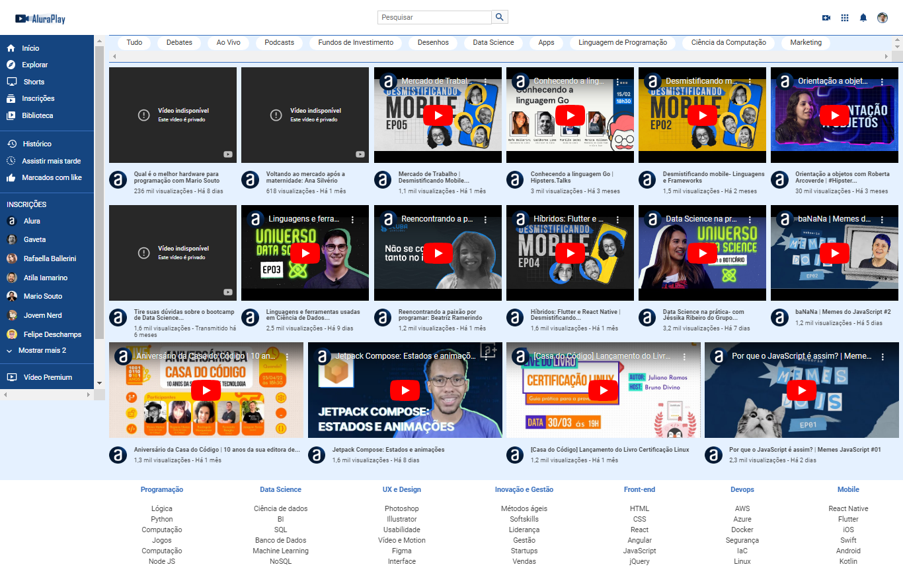

<h1 align="center">✨ CSS: Flexbox e layouts responsivos</h1>

<section align="center">
    <h2>✨ Linguagens & Tecnologias Usadas para o desenvolvimento desse repositório</h2>
    

        
        
        
        
    

</section>

<h1 align="center">📃 Tópicos aprendidos</h1>

- [x] Aprenda a utilizar propriedades do Flexbox na prática construindo um projeto responsivo
- [x] Altere o eixo de itens para horizontal ou vertical
- [x] Aplique vídeos de forma responsiva utilizando propriedades Flexbox
- [x] Conheça as características do Flexbox
- [x] Integre as propriedades Flexbox com outras propriedades CSS

  <h2>💻 Preview プレビュー</h2>
    
   
  

